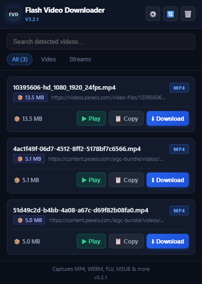
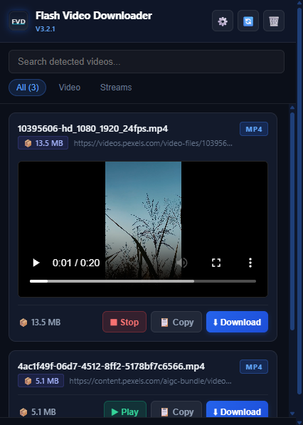
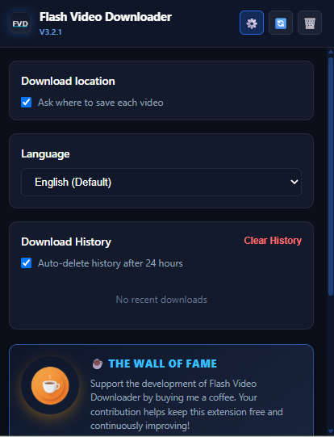

# Flash Video Downloader

<p align="center">
  
</p>

<p align="center">
  <strong>Detect and save openly accessible videos from the page you are viewing.</strong><br/>
  Manifest V3 · Free to install · Optional Pro via Ko-fi · Created by nRn World
</p>

<p align="center">
  <a href="https://chromewebstore.google.com/detail/blbajmihakahbldejkginpccillhakdg"></a>
  <a href="https://github.com/nRn-World/FlashVideoDownloader"></a>
  <a href="https://developer.chrome.com/docs/extensions/mv3/"></a>
  <a href="LICENSE"></a>
  <a href="https://ko-fi.com/s/72a48b875e"></a>
</p>

---

## Overview

**Flash Video Downloader** helps you save videos you are already watching on supported websites. It combines network sniffing with on-page video detection, so you get a clean list of downloadable media instead of dozens of unrelated segment URLs.

The extension focuses on **visible page videos**, offers **pause / resume / cancel** during downloads, lets you choose **where files are saved**, and ships with **6 languages**.

### Free vs Pro

| | Free | Pro |
|---|---|---|
| Detect, preview, pause / resume / cancel | Yes | Yes |
| Downloads every 2 hours | **1** | Unlimited |
| Concurrent downloads | 1 | 3 |
| Download history | Last 10 | Unlimited |
| Ads in the popup | Shown | **None** |
| Price | Free | **EUR 10.99** one-time, lifetime |

Buy Pro on [Ko-fi](https://ko-fi.com/s/72a48b875e). After payment, copy the license key from the thank-you page, then either paste it into the **front-page Pro card** under **Already have a license key?** or open the extension → **Settings** → **Pro** → paste key → **Activate**.

> **Important:** This extension does not bypass DRM. Sites such as YouTube, Netflix, Twitch, Disney+, and Spotify are blocked by design for Chrome Web Store compliance, as are TikTok, Instagram, Facebook, X, Hulu, Paramount+, Peacock and Crunchyroll (their terms forbid downloading). Copyright notices: bynrnworld@gmail.com.

---

## Screenshots

<p align="center">
  
</p>

<p align="center">
  <em>Detect videos on the page, preview them, and download with one click.</em>
</p>

<table align="center">
  <tr>
    <td align="center" width="50%">
      <br/>
      <sub>Live progress with pause, resume, and cancel</sub>
    </td>
    <td align="center" width="50%">
      <br/>
      <sub>Settings, history, folder picker, and Pro upgrade</sub>
    </td>
  </tr>
</table>

---

## Features

| Category | Details |
|---|---|
| **Detection** | Network sniffing + visible `<video>` scanning on the active tab |
| **Formats** | MP4, WEBM, FLV, MKV, MOV, AVI, M3U8, MPD, TS, MP3, and more |
| **HLS / streams** | Offscreen pipeline merges segments into a playable file (TS → MP4 remux via mux.js) |
| **Download control** | Pause, resume, cancel, and global active-download banner |
| **Save location** | Ask each time, or save all videos to a folder you pick on your computer |
| **Languages** | English, Svenska, Türkçe, Español, Français, العربية |
| **History** | Last 10 (Free) or unlimited (Pro), optional 24-hour auto-cleanup |
| **Rate limits** | Free: 1 download every 2 hours, 1 concurrent. Pro: unlimited, 3 concurrent |
| **Pro** | Optional EUR 10.99 lifetime license via [Ko-fi](https://ko-fi.com/s/72a48b875e) |
| **Ads** | Free users see a small bundled "Sponsored" banner (an affiliate offer, or a house ad as fallback); Pro sees none |
| **Privacy** | On-demand content script injection · no analytics · no third-party code inside the extension · blocked-host list |

---

## Download

**[⬇ Add Flash Video Downloader from the Chrome Web Store](https://chromewebstore.google.com/detail/blbajmihakahbldejkginpccillhakdg)**

1. Open the store listing
2. Click **Add to Chrome**
3. Pin **Flash Video Downloader** to your toolbar

---

## Installation from source

```bash
git clone https://github.com/nRn-World/FlashVideoDownloader.git
cd FlashVideoDownloader
```

For a clean build containing only the files that ship to the store (no screenshots or local dev files), run `python prepare_local_test.py` and select the generated `local-test` folder instead of the project root.

1. Open `chrome://extensions/`
2. Enable **Developer mode**
3. Click **Load unpacked**
4. Select the project folder (or `local-test`)
5. Pin **Flash Video Downloader** to your toolbar

Do not test on `chrome://` pages (including `chrome://extensions`). Open a normal website, play a video, then open the popup.

### Update a local install

```bash
git pull origin main
```

Then click **Reload** on the extension card in `chrome://extensions/`.

On first run the welcome page opens with the legal notice, and the popup stays locked behind the Terms of Service until they
are accepted. The same check runs in `background.js`, so a download cannot start without an accepted record — see
[terms-gate.js](terms-gate.js) and section 1 of [terms.html](terms.html).

---

## How to use

1. Open a supported website and **play the video** you want to save.
2. Click the extension icon.
3. Press **Refresh** if the video does not appear immediately.
4. Click **Download**.
5. Use **Pause**, **Resume**, or **Cancel** from **Active Downloads**.
6. Open **Settings** for language, download folder, history, and Pro.

### Activate Pro

1. Buy a license: [ko-fi.com/s/72a48b875e](https://ko-fi.com/s/72a48b875e) (EUR 10.99, lifetime).
2. Copy the key from the Ko-fi thank-you page.
3. Paste the key either in the front-page Pro card (**Already have a license key?**) or in **Settings → Pro**, then press **Activate**.

> **All sales are final.** The Pro licence is non-refundable and buyers are not entitled to compensation if the extension
> stops working or is discontinued. The purchase button and the welcome page both carry this notice, and the full policy is
> in [terms.html](terms.html#refunds).

### Download location

- **Default:** Chrome asks where to save each video.
- **Fixed folder:** Disable “Ask where to save each video” and choose a folder. Later downloads go there automatically.

---

## Supported formats

<details>
<summary><strong>View full format list</strong></summary>

`mp4`, `m4v`, `m4s`, `fmp4`, `webm`, `flv`, `f4v`, `m3u8`, `m3u`, `mpd`, `ts`, `m2ts`, `mts`, `mov`, `avi`, `mkv`, `ogv`, `3gp`, `3g2`, `wmv`, `mp3`, `m4a`, `aac`, `wav`, `ogg`, `opus`, `flac`, plus `blob:` sources from in-page players.

</details>

---

## Project structure

| File | Purpose |
|---|---|
| `manifest.json` | MV3 manifest, permissions, CSP, locales |
| `background.js` | Network sniffing, download state, offscreen orchestration, rate limits |
| `offscreen.js` | HLS/generic download engine, blob merge, file delivery |
| `content.js` | Visible video DOM scan (on-demand injection) |
| `popup.js` / `.html` / `.css` | UI, settings, history, progress, Pro upgrade |
| `license.js` | Pro license check and Free download window (1 per 2 hours) |
| `ads.js` | Free-tier ad slot: your affiliate offers (configurable) with house-ad fallback, hidden for Pro |
| `blocked-hosts.js` | DRM / policy-restricted platform blocklist |
| `storage-handles.js` | File System Access directory handle persistence |
| `i18n.js` | In-extension translations |
| `privacy.html` | Privacy policy ([live](https://nrn-world.github.io/FlashVideoDownloader/privacy.html)) |
| `welcome.html` / `welcome.js` | First-run page, including the legal notice and Terms acknowledgement |
| `terms.html` | **End User License Agreement & Terms of Service** — liability, warranty, no-refund policy ([live](https://nrn-world.github.io/FlashVideoDownloader/terms.html)) |
| `terms-gate.js` | Terms acceptance gate: versioned record, checked by the popup and by `background.js` before any download starts |
| `pages/pro.html` | Pro landing page on GitHub Pages |
| `workers/fvd-rate-limit.js` | Optional Cloudflare Worker to keep the Free limit after reinstall |

---

## Ads & affiliate links (Free tier)

Free users see a small "Sponsored" banner in the popup; Pro removes it. Program recommendations and a step-by-step walkthrough live in [AFFILIATE-GUIDE.md](AFFILIATE-GUIDE.md). Configure your own offers in `ads.js` → `AFFILIATE_OFFERS`: paste your personal tracking link and keep `enabled: true`. Any offer without an `https://` link is skipped, and the built-in house ads are shown as a fallback until at least one affiliate link is configured. Impressions and clicks are counted locally in `chrome.storage.local` (`fvd_ad_stats`) — nothing is sent anywhere.

> **Note:** Google AdSense may not be used in Chrome extensions (Chrome Web Store *Ads* policy), and Manifest V3 blocks remote scripts, so ads must be your own or delivered server-side.

---

## Building a release ZIP

```bat
create_zip.bat
```

See `STORE_LISTING.md` for Chrome Web Store listing text and the privacy-policy URL. The ZIP includes `terms.html`
(the End User License Agreement) and `welcome.js`; a build fails loudly if either is missing.

---

## Support the project

- **Pro license (EUR 10.99 lifetime):** [ko-fi.com/s/72a48b875e](https://ko-fi.com/s/72a48b875e)
- **Tip / coffee:** [ko-fi.com/nrnworld](https://ko-fi.com/nrnworld)

---

## License

Two layers, and they cover different things:

**1. The source code in this repository** is licensed under the
**Creative Commons Attribution-NonCommercial 4.0 International License (CC BY-NC 4.0)**.

- You may share and adapt the material for **non-commercial** use.
- You must give **appropriate credit** and link to the license.
- See [`LICENSE`](LICENSE) for the full text.

**2. Using the distributed extension and the paid Pro licence** is governed by the
[End User License Agreement & Terms of Service](terms.html)
([live](https://nrn-world.github.io/FlashVideoDownloader/terms.html)). Installing, using or buying the extension means you
accept it. It contains:

- the **warranty disclaimer** (“as is”, no promise that the extension works on any site or keeps working);
- the **limitation of liability**, capped at the amount paid (see also section 9 — no compensation if the extension stops
  working or is discontinued);
- the **indemnity** you give the developer for how you use the extension;
- the **[no-refund policy](terms.html#refunds)** for Pro purchases, including the express request for immediate access that
  waives the statutory right of withdrawal;
- the restrictions on commercial use, key sharing and prohibited use.

Where the Agreement would restrict a right that CC BY-NC 4.0 grants you in respect of the source code, CC BY-NC 4.0 prevails
for the source code only.

---

## Contact

**nRn World**  
Email: [bynrnworld@gmail.com](mailto:bynrnworld@gmail.com)  
GitHub: [nRn-World/FlashVideoDownloader](https://github.com/nRn-World/FlashVideoDownloader)  
Chrome Web Store: [Flash Video Downloader](https://chromewebstore.google.com/detail/blbajmihakahbldejkginpccillhakdg)  
Privacy policy: [nrn-world.github.io/FlashVideoDownloader/privacy.html](https://nrn-world.github.io/FlashVideoDownloader/privacy.html)  
Terms of Service: [nrn-world.github.io/FlashVideoDownloader/terms.html](https://nrn-world.github.io/FlashVideoDownloader/terms.html)

---

## Changelog

| Version | Highlights |
|---|---|
| **3.5.3** | Pro licenses are now verified against a license server, so Pro cannot be unlocked by editing local storage. Existing Pro users keep Pro without re-entering their key, including when offline. |
| **3.5.2** | Copyright hardening: more platforms blocked (TikTok, Instagram, Facebook, X, Snapchat, Hulu, Paramount+, Peacock, Crunchyroll), rights-holder contact in the Terms, store listing and README, full Apache-2.0 text for mux.js. Chrome and Firefox builds now share one version number. |
| **3.5.1** | **Firefox only** — the build number for the AMO upload (`FIREFOX_VERSION` in `prepare_firefox_zip.py`); `manifest.json` in the source and the Chrome package stay at 3.5.0. Adds **Firefox for Android** support: the package opts in through `browser_specific_settings.gecko_android`, and because that browser has no downloads API (Mozilla bug 1538348, still open) the download engine runs in a real tab there and offers the finished file as an `<a download>` link the user taps to save, while a `blob:` video is read through the content script instead of a click the extension makes on the user's behalf. Desktop is untouched — it still saves through the downloads API, and the folder settings are only hidden where that API does not exist. Nine device-only test cases are listed in `TESTING.md`. |
| **3.5.0** | Legal and compliance release. A **Terms of Service gate** now locks the popup and every download start until the user accepts, with the accepted version and timestamp stored (`terms-gate.js`); the full EULA ships as `terms.html` (liability, warranty, no-refund and indemnity sections, Swedish law) and is linked from the welcome page, the popup, Settings, the footer and the Pro landing page. The **fictitious compare-at price is gone** — no struck-through "€21.98", no "50% OFF" and no urgency countdown unless a real reduction is configured against the lowest price actually charged in the last 30 days. Marketing copy no longer promises the licence lasts "forever", and the privacy policy gains a controller, legal-basis, retention and data-subject-rights section. Version bumped for store submission. |
| **3.4.1** | The Back button in Settings is now pinned outside the scrolling area, so returning to the video list is always one click away instead of hiding below the Pro card, history and credits; the header gear toggles back to the video list too. Adds `Strict-Transport-Security` and `Referrer-Policy` to the optional rate-limit worker. |
| **3.4.0** | License key entry in the front-page Pro card (**Already have a license key?**) so a buyer no longer has to open Settings, the offer card moved above the affiliate banner so it is read first, and a successful activation is confirmed on screen before the card closes |
| **3.3.9** | Pro offer card on the front page (50 % launch price, crossed-out regular price, live countdown, lifetime license), free tier relaxed to 1 download every 2 hours, and the affiliate banner keeps its space next to the card |
| **3.3.8** | Parallel multi-threaded chunk downloading engine for accelerated speeds, sponsor choice modal for free-tier with localized options in 6 languages, integrated Adsterra Smartlink monetization |
| **3.3.7** | Universal video player detection (Video.js, JWPlayer, schema.org VideoObject, OpenGraph, tube CMS `/vid2/`), page Referer passing for CDN downloads with 403 fallback to offscreen download, and exact toolbar badge sync matching popup video count |
| **3.3.5** | Detect DRM-protected streams and stop with a clear message instead of downloading a file that can only play as black or distorted picture with no sound. Encrypted DASH representations are skipped, a clear variant is used when the manifest offers one, and the stream is refused after a single small request rather than after gigabytes |
| **3.3.4** | Fix all media formats being missed: real video files under `/preview/` paths are no longer treated as thumbnails, `<a download>` links are scanned, off-screen and non-MP4 containers (AVI/MKV/FLV/3GP/WMV) are detected and listed, and all detected items are shown instead of the top 3. Repaired corrupted locale files (emoji + Swedish characters) that blocked the extension from loading |
| **3.3.3** | Review prompt at download milestones; fix download % stuck at 15%; realtime progress UI |
| **3.3.2** | Fix service-worker message handling that showed as an error in `chrome://extensions` |
| **3.3.1** | Freemium: Free 1 download/hour; Pro lifetime via Ko-fi (EUR 10.99) |
| **3.3.0** | First Pro/Free split (later priced at EUR 10.99 on Ko-fi) |
| **3.2.5** | Better detection for tube/CMS URLs (`.mp4/`, `/get_file/`), iframe scan, less aggressive preview filter |
| **3.2.4** | Stronger HLS/DASH downloads: page Referer retries, lower parallelism, segment repair, MPD support |
| **3.2.3** | Fix post-download crash (`chrome.storage`), save HLS/blob via offscreen `chrome.downloads` |
| **3.2.2** | Direct `chrome.downloads` for MP4/WEBM, safer defaults for store review, blob via content script |
| **3.2.1** | Chrome Web Store readiness, DRM blocklist, visible-video filtering, folder picker, CC BY-NC license |
| **3.2.0** | Pause/resume/cancel, smooth progress, universal download pipeline, blob support |
| **3.1.0** | Offscreen HLS engine, global active-downloads banner |
| **3.0.0** | i18n, download history, in-popup preview |

---

<p align="center">
  Created by ❤️ © nRn World
</p>
